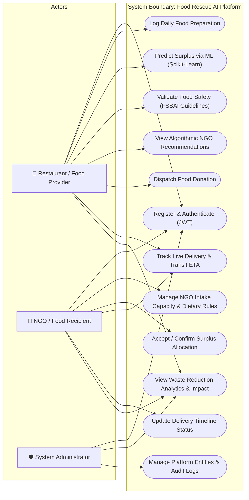
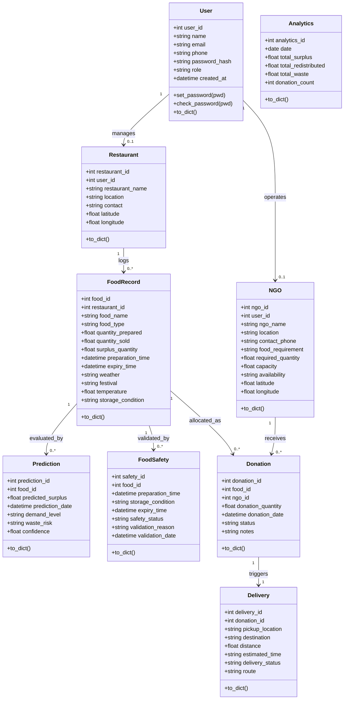
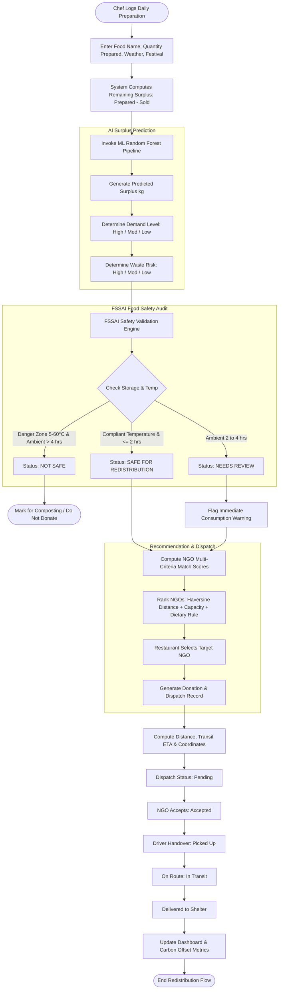
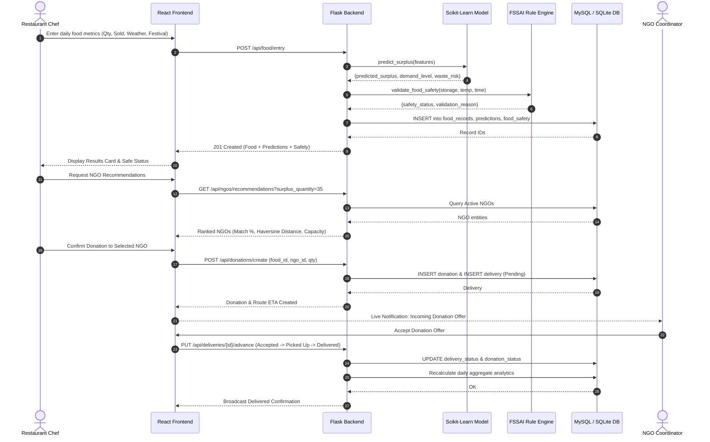
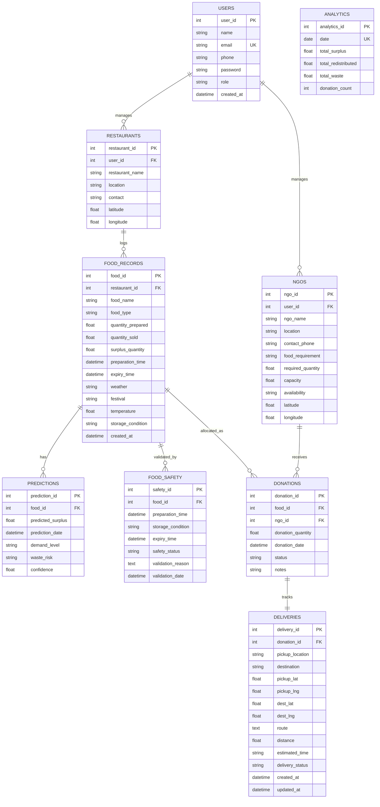
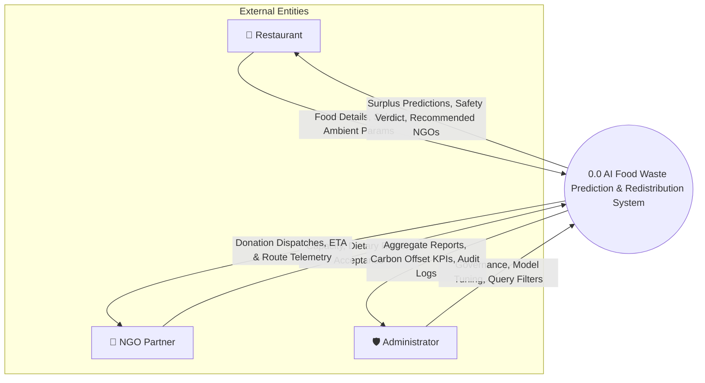
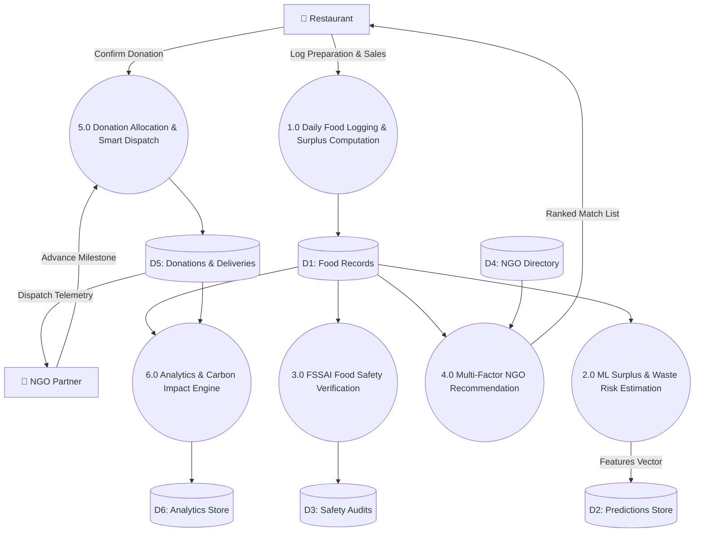

# AI-Based Food Waste Prediction and Redistribution System
## Formal Software Engineering UML & Architectural Diagrams

This document contains the standard software engineering design diagrams representing the architecture, data models, and dynamic behaviors of the platform.

---

### 1. Use Case Diagram

---

### 2. Class Diagram

---

### 3. Activity Diagram (Surplus Lifecycle)

---

### 4. Sequence Diagram (Food Logging to Delivery)

---

### 5. Entity-Relationship (ER) Diagram

---

### 6. Data Flow Diagram (DFD)

#### Level 0 DFD (Context Diagram)

#### Level 1 DFD (Decomposition)

